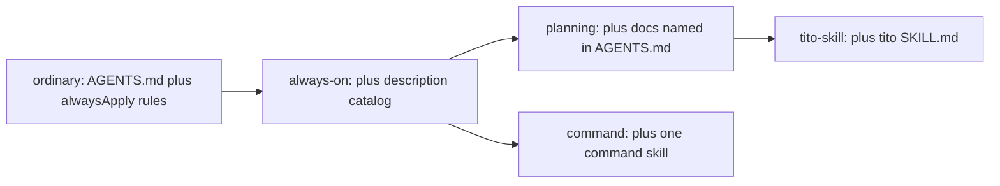

# Tito token budget eval

## Domain

**Business impact:** you can see what each Tito step costs before you spend on it, and a change that makes a step more expensive fails `npm test` instead of quietly burning more tokens.

**Terms:**
- **Load path:** the set of instruction text the agent reads for one kind of turn.
- **Description catalog:** text Cursor shows on every turn without loading the body. That covers sub-agent descriptions, rule descriptions (rules with `alwaysApply: false` and no `globs`), and skill descriptions, except skills marked `disable-model-invocation: true`.
- **Budget:** the brief's limit for a path.
- **Ceiling:** today's measured size of a path that is already over budget. It may only go down.

**Rules:**
- Token counts are estimates, using `Math.ceil(chars / 4)`, the same as the existing tests in [test/init.test.mjs](test/init.test.mjs) and [test/work-plan.test.mjs](test/work-plan.test.mjs).
- A path passes if it is within budget. A path over budget passes only if it is at or below its ceiling.
- The eval reads files and writes nothing.

**Who uses it:** you, while developing Tito, and CI.

## Decisions

1. **Where the code lives:** an internal core module, [src/core/budgets.ts](src/core/budgets.ts), with no CLI command and no chat entry, so there is no public contract. Tests import it from `dist/core/budgets.js`, the same way the other tests do. Principle: adopt before building; it reuses the existing test harness.
2. **How load paths are found:** from the bootstrap text. Every `.md` file wrapped in backticks in `AGENTS.md` joins the planning path. When the cut slice removes the brief-reading line, the number drops without anyone editing the eval.
3. **Which descriptions count:** the catalog counts what Cursor's docs say it shows on every turn (checked against cursor.com/docs: rules, skills and subagents; verdict trusted).
   - Sub-agent `description:` values from `.cursor/agents/*.md`.
   - Rule `description:` values when `alwaysApply: false` and there are no `globs`.
   - Skill `description:` values, except skills marked `disable-model-invocation: true`. All Tito skills are marked that way today, so their count is 0.
4. **Paths and budgets:**

| Path | What it adds up | Budget |
| --- | --- | --- |
| `ordinary` | `AGENTS.md` and rules with `alwaysApply: true` | 1,500 (bootstrap) |
| `always-on` | `ordinary` plus the description catalog | 2,100 (bootstrap plus 600 for the catalog) |
| `planning` | `always-on` plus the docs `AGENTS.md` references | 4,100 (plus 2,000 domain context) |
| `tito-skill` | `planning` plus the `tito` skill file | 5,300 (plus 1,200 task packet) |
| `command:<name>` | `always-on` plus that command skill file | 2,500 |
| `card:<name>` | one whole specialist card | 400 (specialist card) |

5. **Ratchet:** a `CEILINGS` record in `budgets.ts`, pinned to the exact numbers measured when the writer runs the eval. Expect about 11,800 for `planning` and 15,100 for `tito-skill`.
6. **Two roots are measured:** the repo itself, and `templates/cursor` as a consumer project would see it. In a consumer project the referenced brief is missing, and the eval reports it in `missing` instead of failing.
7. **Readable output:** the integration test prints one row per path through `t.diagnostic`, showing path, tokens, budget, ceiling and status.
8. **Front matter is parsed with a small regex** for `description`, `alwaysApply`, `globs` and `disable-model-invocation`. No YAML dependency; it handles the `>` folded block that the cards use.

Guidance code:

```ts
export type PathReport = {
  id: string;
  files: string[];
  missing: string[];
  tokens: number;
  budget: number;
  ceiling?: number;
};
export const estimateTokens = (text: string): number => Math.ceil(text.length / 4);
export function descriptionCatalog(root: string): { source: string; text: string }[];
export function measurePaths(root: string): PathReport[];
export function budgetFailures(reports: PathReport[]): string[]; // "planning: 11812 > ceiling 11800"
```



## Test cases

All tests are in [test/budgets.test.mjs](test/budgets.test.mjs).

- **E1 [unit]**
  - Arrange: the text `"abcde"`.
  - Act: call `estimateTokens`.
  - Assert: the result is `2`.
- **E2 [unit]**
  - Arrange: a temporary root whose `AGENTS.md` mentions `` `X.md` ``, and an `X.md` of 400 characters.
  - Act: call `measurePaths`.
  - Assert: `planning` lists `X.md`, and its tokens equal `always-on` plus 100.
- **E3 [unit]**
  - Arrange: a temporary root whose `AGENTS.md` mentions no `.md` file.
  - Act: call `measurePaths`.
  - Assert: `planning` tokens equal `always-on` tokens.
- **E4 [unit]**
  - Arrange: a temporary root whose `AGENTS.md` mentions a file that does not exist.
  - Act: call `measurePaths`.
  - Assert: that file is in `planning.missing`, and nothing throws.
- **E5 [unit]**
  - Arrange: a temporary root with one card using a folded `description: >` block; one rule with a description, no globs and `alwaysApply: false`; one rule with globs; one skill without `disable-model-invocation`; and one skill marked `disable-model-invocation: true`.
  - Act: call `descriptionCatalog`.
  - Assert: it returns exactly the card, the description-only rule and the model-invocable skill.
- **E6 [unit]**
  - Arrange: a rule with `alwaysApply: true`.
  - Act: call `measurePaths`.
  - Assert: the whole rule file is counted in `ordinary`.
- **E7 [unit]**
  - Arrange: two reports, one over its ceiling and one over budget but at its ceiling.
  - Act: call `budgetFailures`.
  - Assert: exactly one failure, naming the path, the measured tokens and the ceiling.
- **E8 [integration]**
  - Arrange: the repo root.
  - Act: measure the paths and print the diagnostic table.
  - Assert: `budgetFailures` is empty.
- **E9 [integration]**
  - Arrange: `templates/cursor` as the root.
  - Act: measure the paths.
  - Assert: `budgetFailures` is empty, and `planning.missing` contains `TITO-INITIAL-BRIEF.md`.
- **E10 [integration]**
  - Arrange: the repo's `.cursor/agents/*.md`.
  - Act: measure each card.
  - Assert: each card is 400 tokens or fewer.

Edge cases:
- Front matter counts toward a file's tokens, because the agent sees it.
- Rules and MCP servers from the parent workspace, outside the repo, are not counted.
- A missing `.cursor/agents` folder gives an empty catalog, not an error.

## Docs impact

This is the spec doc, written first: add two lines under "Token-efficiency contract" in [TITO-INITIAL-BRIEF.md](TITO-INITIAL-BRIEF.md).
- `test/budgets.test.mjs` checks the load paths, including the description catalog Cursor shows on every turn.
- A path over budget carries a ceiling that may only go down.

No README change.

## Slices and branch

There is one slice.
- **Branch:** `feat/token-budget-eval` from `main`, checked out only after you accept.
- **Test-first commit 1:** only [test/budgets.test.mjs](test/budgets.test.mjs). E1 to E10 fail on import because `dist/core/budgets.js` does not exist.
- **Commit 2:** [TITO-INITIAL-BRIEF.md](TITO-INITIAL-BRIEF.md) and [src/core/budgets.ts](src/core/budgets.ts). No test file is touched.
- **Example subject:** `feat: add a token budget eval for Tito load paths.`
- **Writer:** the `tito-backend` sub-agent on Grok 4.7 high (`grok-4.7-high`).
- **Skills the writer must read:** none of the installed skills match this slice.
- **Diff budget:** about 250 authored lines across 3 files.
- **Forbidden:** changes to `AGENTS.md`, skills, rules, cards, `tito.yaml` or `src/core/config.ts`.
- **Stop condition:** E1 to E10 pass, `npm test` is green, the build passes. Report the measured numbers per path.
- **Plan feedback:** save under `.tito/feedback/token-budget-eval/` after approval.

**Follow-ups, not in this slice:**
- **Cuts slice** (needs its own plan):
  - Split the brief into rules chosen by description.
  - Move the `tito` skill's detail into `references/`.
  - Stop the shipped template from pointing at a brief that isn't installed.
- **Hooks plan:** enforce the main gates with deterministic `.cursor/hooks.json` hooks.
- **Stale model pin:** the explorer is pinned to `cursor-grok-4.6-medium-fast` in [tito.yaml](tito.yaml) and in the defaults in [src/core/config.ts](src/core/config.ts). That slug is no longer in the model catalog; it is now `cursor-grok-4.6-high`.
- **Usage eval later:** measure real token usage per scenario with Cursor SDK `TokenUsage`.
